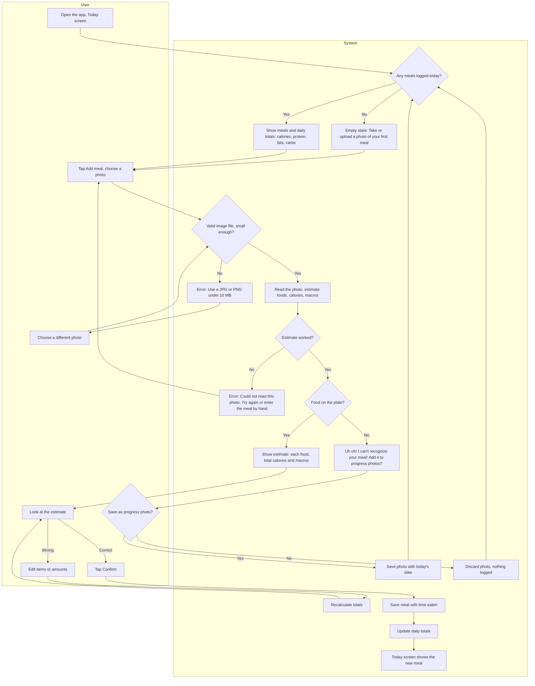

# Flow: Log a meal from a photo (S1)

> DRAFT for the student to check. Covers S1-AC1 to S1-AC4 (see `specs/user-stories.md`).

The flow has two lanes: the **User** and the **System** (which includes the AI that reads the
photo). Every decision has an answer for both branches, including errors and empty states.

## Which story criterion each part satisfies

| Part of the flow | Criterion |
|---|---|
| Read the photo and estimate calories and nutrients | S1-AC1 |
| Look at the estimate, edit, then Confirm | S1-AC2 |
| Not a meal: "Uh oh!" message, save as progress photo or discard | S1-AC3 |
| Save meal with time, update daily totals | S1-AC4 |
| Empty state: invite first photo | S1-AC5 |
| Invalid or oversized file | S1-AC6 |
| Estimate failed: try again or enter by hand | S1-AC7 |

## Still to decide

- **Cancel path.** Can the user back out partway (for example after choosing a photo, or while
  looking at the estimate) and return to the Today screen with nothing logged? The flow has no
  cancel path yet.

Decided: keep "enter the meal by hand" as the fallback when the estimate fails. After discarding
a non-meal photo, the user returns to the Today screen.
