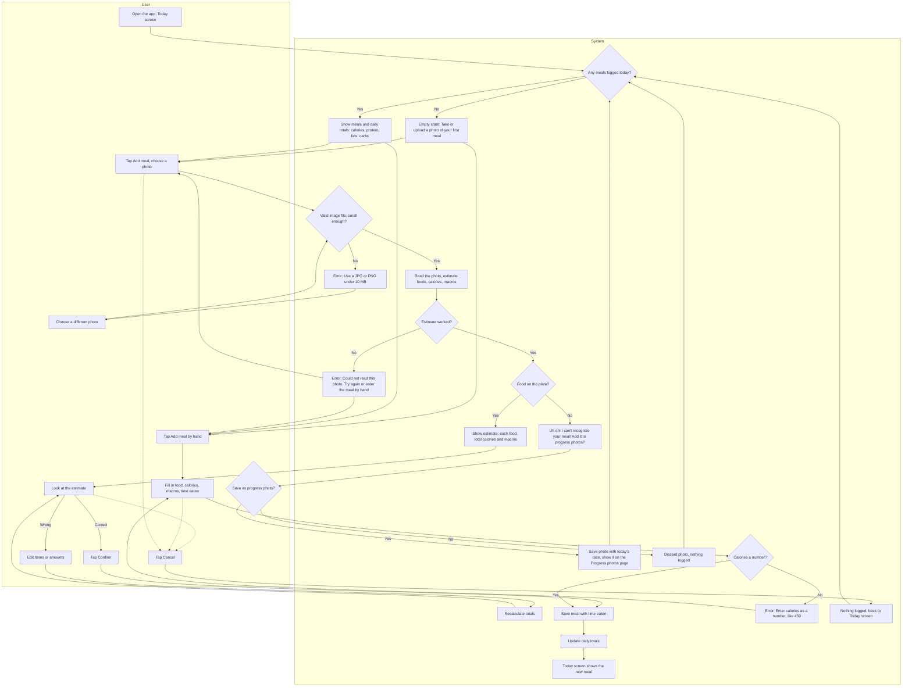

# Flow: Log a meal from a photo (S1)

> DRAFT for the student to check. Covers S1-AC1 to S1-AC4 (see `specs/user-stories.md`).

The flow has two lanes: the **User** and the **System** (which includes the AI that reads the
photo). Every decision has an answer for both branches, including errors and empty states.

## Which story criterion each part satisfies

| Part of the flow | Criterion |
|---|---|
| Read the photo and estimate calories and nutrients | S1-AC1 |
| Look at the estimate, edit, then Confirm | S1-AC2 |
| Not a meal: "Uh oh!" message, save as progress photo or discard | S1-AC3 |
| Save meal with time, update daily totals | S1-AC4 |
| Empty state: invite first photo | S1-AC5 |
| Invalid or oversized file | S1-AC6 |
| Estimate failed: try again or enter by hand | S1-AC7 |
| Cancel before confirming, nothing logged (dotted lines) | S1-AC8 |
| Add meal by hand at any time, choose the time eaten | S1-AC9 |
| Calories missing or not a number | S1-AC10 |

## Decided

- "Enter the meal by hand" is both a fallback when the estimate fails and a button you can use
  any time (for example to log something you ate earlier).
- Cancel is available at every step before Confirm and returns to the Today screen with nothing
  logged.
- After discarding a non-meal photo, the user returns to the Today screen.
- "Offline" means manual: if you ate something and forgot to log it with a photo, you can still
  enter the calories by hand later (S1-AC9). Working with no internet connection is not in v1.
