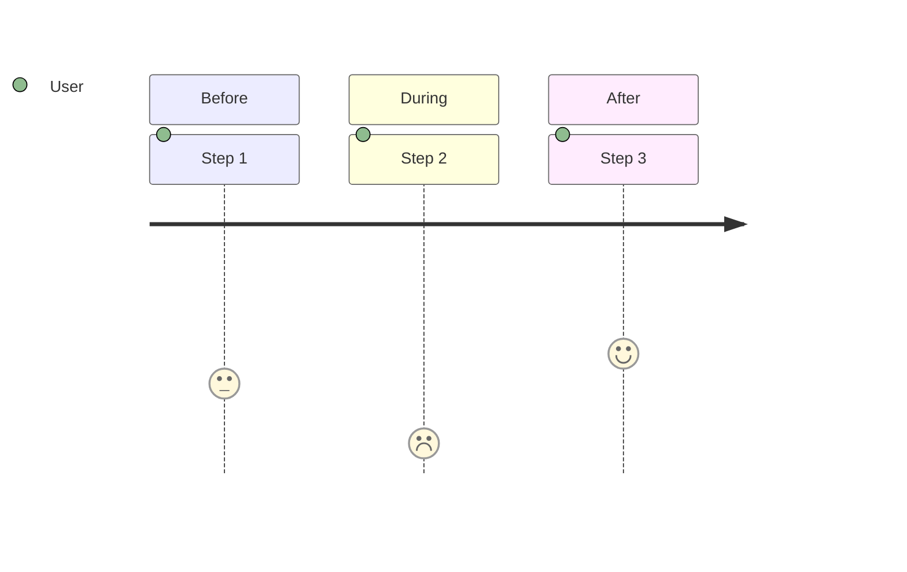

# Requirements: <system name>

## Problem statement
<One paragraph: who, what goes wrong, how often, what it costs them. Cite interviews.>

## Job to be done
When I'm ___, I want to ___, so I can ___.

## Users and stakeholders
| Role | Who (initials or title) | What they need from the system |
|---|---|---|
| Primary user | | |
| Stakeholder (pays, approves, or is affected) | | |

**Not for:** <who this system is deliberately not designed for>

## Persona
<Name, role, context, goals, frustrations, current tools. One short paragraph.>

## Current process (as-is)
1.
2.
3.

## Journey map

## Functional requirements
| ID | The system shall... | Priority (Must / Should / Could / Won't) | Source |
|---|---|---|---|
| FR-1 | | Must | Interview 1 |

## Non-functional requirements
| ID | Category (usability, security, performance, privacy, cost) | Requirement | Source |
|---|---|---|---|
| NFR-1 | Privacy | | |

## Riskiest assumption
<The belief that, if false, makes the system pointless. How you will test it.>

## MVP scope
**In:** <the Must items only>
**Out:** <everything else, and why>
