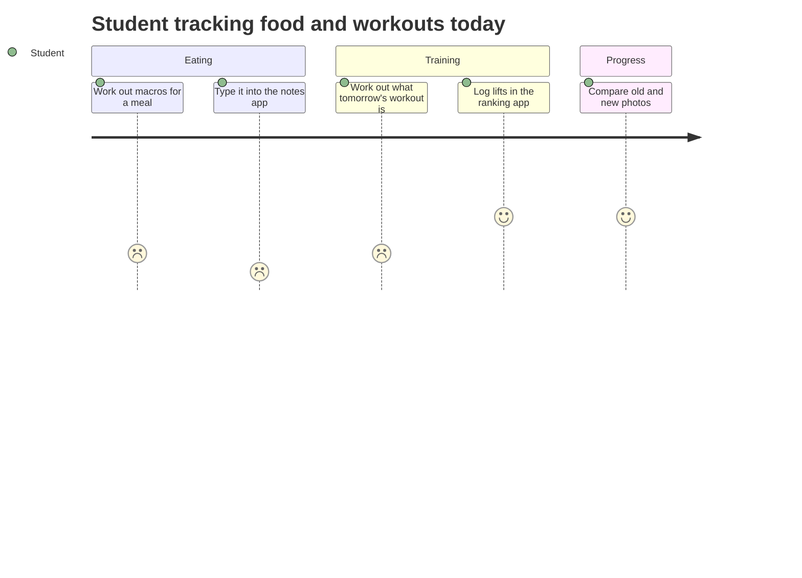

# Requirements: Fitness and Calorie Tracker (working name)

> Draft. Built only from Interviews 1, 2, and 3. Items marked **[decide]** are choices for you to confirm.

## Problem statement
College students who are trying to stay consistent with diet and the gym find tracking too slow and scattered. One interviewee tried writing calories, protein, fats, and carbs in a phone notes app every day, and "it just took a lot of time to really write everything down" (Interview 1). Another lifts on a split that changes each visit and has trouble seeing what the next workout is (Interview 2). Both rely on separate tools (a notes app, a photo app, a lifting-ranking app) and nothing shows food, workouts, and progress together. A third interviewee already tracks fitness well with an Apple Watch and the Apple Health app and questions whether he needs another app (Interview 3), so the problem is not universal. Frequency and cost in time or money were not quantified in any interview.

## Job to be done
When I'm balancing school and a busy life while trying to eat and train consistently, I want to log what I eat and lift in one place with almost no effort, so I can stay consistent and see my progress. (Interviews 1 and 2.)

## Users and stakeholders
| Role | Who (initials or title) | What they need from the system |
|---|---|---|
| Primary user | Student tracking diet and macros (Interviewee A) | Fast logging of food, calories, and macros with "what I'm eating, when I'm eating it" (Int. 1) |
| Primary user | Student who lifts on a changing split (Interviewee B) | Log lifts, see the next workout, see lagging muscle groups, simplify a cut or bulk (Int. 2) |
| Non-target (skeptic) | Interviewee C, already uses Apple Watch and Apple Health | Not sure he needs another app; asks what happens if he doesn't want his data stored (Int. 3) |
| Stakeholder (affected) | Anyone whose body data is stored | Their data is not shared with "a bunch of random people" (Int. 2) |

**Not for:** People whose current setup already works well, such as someone using an Apple Watch with Apple Health (Interview 3). The goal is to lower the barrier for people who want to get into fitness. [decide] not yet interviewed: competitive athletes, people with medical diets, or coaches managing many clients.

## Persona
[decide, write in your own words.] Evidence so far: a college student balancing "school, my exciting lifestyle, and everything else" (Int. 1) who wants to cut or bulk (Int. 2). Goals: stay consistent, see progress. Frustrations: logging takes too long; no view of the next workout. Current tools: phone notes app, photo app, a lifting-ranking app.

## Current process (as-is)
1. Eat a meal or snack. (Int. 1)
2. Work out calories, protein, fats, and carbs, then type them into the phone notes app. (Int. 1)
3. Repeat through the day; entries get skipped when it "took a lot of time." (Int. 1)
4. Go to the gym with a split that changes each visit. (Int. 2)
5. After lifting, tell the ranking app what was lifted and get a bronze-to-diamond rank per movement. (Int. 2)
6. Take progress photos and videos and compare old and new in the photo app. (Int. 1)
7. Alternative path: an Apple Watch paired with Apple Health tracks activity and calories without manual entry. (Int. 3)

## Journey map
Mood scores are my reading of the interviews (1 bad, 5 good); adjust them to what your interviewees said.

## Functional requirements
| ID | The system shall... | Priority (Must / Should / Could / Won't) | Source |
|---|---|---|---|
| FR-1 | let a user log a food entry with calories, protein, fats, and carbs | Must | Interview 1 |
| FR-2 | record the time each food entry was eaten | Must | Interview 1 |
| FR-3 | show daily totals of calories and each macro | Must | Interview 1 |
| FR-4 | let a user log a workout (exercise and weight lifted) | Must | Interview 2 |
| FR-5 | show the user what their next workout is, given a changing split | Should | Interview 2 |
| FR-6 | show which muscle groups the user is lacking | Should | Interview 2 |
| FR-7 | support a cut or bulk goal using food tracking | Should | Interview 2 |
| FR-8 | let a user store and compare progress photos over time | Could | Interview 1 |
| FR-9 | rank a lift against other people (bronze to diamond) | Could | Interview 2 |
| FR-10 | let a user track body fat | Could | Interview 2 |
| FR-11 | pull calories burned from the Apple Health app and Apple Watch | Could | Interview 3 (planned integration), practice interview |
| FR-12 | send reminders to work out and log food | Should | Idea from Interview 3; not yet validated by users |

## Non-functional requirements
| ID | Category | Requirement | Source |
|---|---|---|---|
| NFR-1 | Privacy | A user's data shall not be shared with other users or third parties without their consent. | Interview 2 |
| NFR-2 | Privacy | Body measurements such as body fat shall be visible only to the user who entered them. | Interview 2 |
| NFR-3 | Usability | Logging a meal shall take noticeably less effort than typing it into a notes app; [decide] set a target, e.g. under N seconds. | Interview 1 |
| NFR-4 | Usability | The system shall be usable on a phone. (Interview 1 tracks "on my phone".) | Interview 1 |
| NFR-5 | Privacy | A user's profile shall be private, and the user shall be able to keep their data stored on their own phone rather than on a server. | Interview 3 |

## Riskiest assumption
Draft: users will keep logging only if entering food takes much less effort than the notes app, and the system can offer that without the user doing the macro math. If false, the app is just another notes app. Interview 3 adds a second risk: people whose Apple Watch and Apple Health setup already works may see no reason to switch, so the app has to be aimed at people just getting into fitness. Test: [decide] time one day of notes-app logging with the interviewee, then have them try a paper or clickable mock-up of the faster flow and compare.

## MVP scope
**In (Must):** FR-1 to FR-4, plus NFR-1, NFR-2, and NFR-5 for privacy.
**Out:**
- FR-5 to FR-7 and FR-12 (Should): useful, but not needed to test the riskiest assumption. FR-12 (reminders) is not yet backed by user evidence.
- FR-8 to FR-11 (Could): photo comparison, rankings, body fat, and Apple Health integration are nice-to-haves nobody asked for first.
